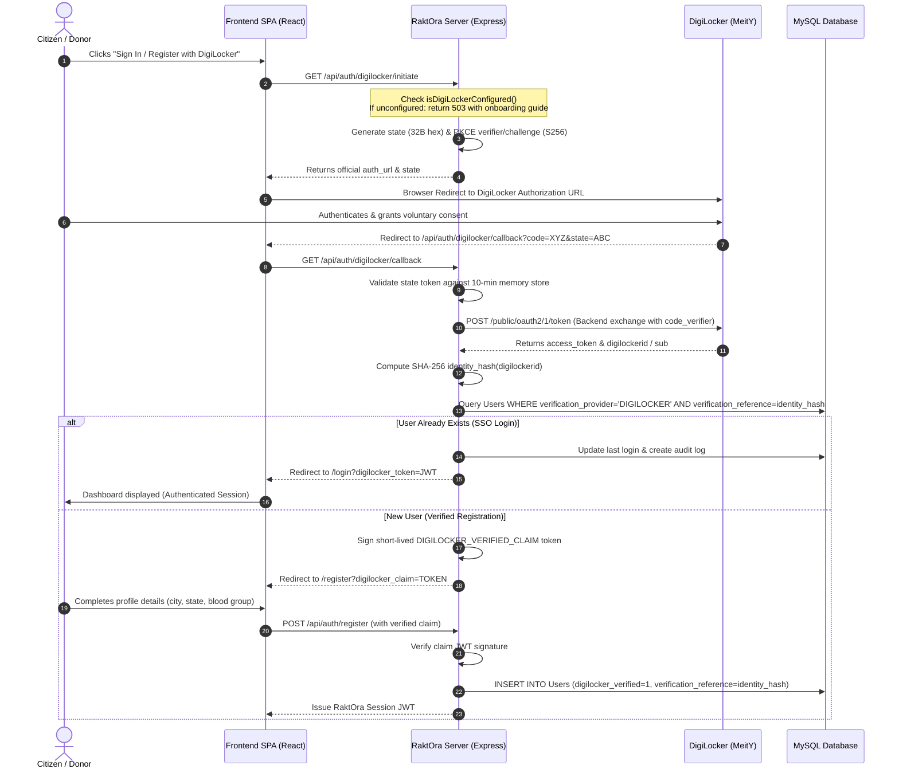

# 🏛️ RaktOra Technical Architecture & Engineering Specifications

This document details the architectural design, security mechanisms, data flows, and concurrency guarantees implemented across the **RaktOra** platform under a permanent ₹0 budget constraint.

---

## 1. System Topology & Zero-Cost Architecture

```text
                                  ┌─────────────────────────────┐
                                  │      Client Browsers        │
                                  │   (Mobile & Desktop SPA)    │
                                  └──────────────┬──────────────┘
                                                 │
                                                 ▼
                                  ┌─────────────────────────────┐
                                  │     Zero-Cost Edge Host     │
                                  │ (Static Assets / HTTPS CDN) │
                                  └──────────────┬──────────────┘
                                                 │
                                                 ▼
┌─────────────────────────────────────────────────────────────────────────────────────────────┐
│                               Express.js Web & API Server                                   │
│                                                                                             │
│  ┌─────────────────────────┐  ┌─────────────────────────┐  ┌─────────────────────────────┐  │
│  │   Static Asset Engine   │  │   Liveness / Readiness  │  │     Security Middlewares    │  │
│  │   (Serves React dist)   │  │   GET /health, /ready   │  │  CORS, Helmet, RateLimiter  │  │
│  └─────────────────────────┘  └─────────────────────────┘  └─────────────────────────────┘  │
│                                                                                             │
│  ┌───────────────────────────────────────────────────────────────────────────────────────┐  │
│  │                               REST Routing Subsystem                                  │  │
│  │  /api/auth  •  /api/donors  •  /api/requests  •  /api/bloodbanks  •  /api/bloodunits  │  │
│  │  /api/appointments  •  /api/hospitals  •  /api/camps  •  /api/admin  •  /api/docs    │  │
│  └───────────────────────────────────────────┬───────────────────────────────────────────┘  │
│                                              │                                              │
│  ┌───────────────────────────────────────────┴───────────────────────────────────────────┐  │
│  │                               Core Domain Services                                    │  │
│  │  ├── DigiLocker OAuth 2.0 PKCE Subsystem (RFC 7636 Authorization Code Grant)          │  │
│  │  ├── FEFO Inventory Allocation Engine (InnoDB Atomic Row Locking FOR UPDATE)          │  │
│  │  ├── Deterministic ABO/Rh Compatibility Engine (Local Matrix Evaluation)              │  │
│  │  ├── NBTC Medical Eligibility Engine (90-day cooldown rules, vitals validation)       │  │
│  │  ├── Local Haversine Distance Calculator (GPS Proximity Sorting)                      │  │
│  │  └── Centralized Audit Logger (Actor ID, Entity Type, Mutation Diff)                  │  │
│  └───────────────────────────────────────────┬───────────────────────────────────────────┘  │
└──────────────────────────────────────────────┼──────────────────────────────────────────────┘
                                               │ Connection Pool (SSL / TLS)
                                               ▼
                              ┌─────────────────────────────────┐
                              │     MySQL 8.0 Cloud Database    │
                              │ (Aiven Free-Tier / Managed DB)  │
                              │  InnoDB, ACID Transactions, SSL │
                              └─────────────────────────────────┘
```

---

## 2. Genuine DigiLocker-First Authentication Flow

RaktOra implements official **OAuth 2.0 Authorization Code Grant with PKCE (Proof Key for Code Exchange, RFC 7636)**:



### 2.1 Identity Deduplication & Privacy
- **Authoritative Reference**: When DigiLocker provides a unique user identifier (`digilockerid`), RaktOra computes a one-way cryptographic SHA-256 hash (`verification_reference`).
- **Privacy Minimization**: Plaintext Aadhaar or national identity numbers are **never stored** in the database.
- **Account Deduplication**: The database enforces uniqueness on `(verification_provider, verification_reference)`. Attempts to register a second account with the same DigiLocker identity are rejected safely.
- **Phone Number Separation**: A phone number alone is never assumed to prove identity.

### 2.2 Strict Zero-Cost Integration Boundary
If authorized DigiLocker partner credentials (`DIGILOCKER_CLIENT_ID`, `DIGILOCKER_CLIENT_SECRET`) are missing:
1. DigiLocker authentication fails closed (HTTP 503).
2. The user interface opens a transparent information modal explaining:
   - DigiLocker requires organizational registration at `partners.digitallocker.gov.in` or `apisetu.gov.in`.
   - In accordance with zero-cost and real-identity standards, mock/fake logins are disabled.
   - Users may continue voluntary registration using standard email and password.
3. No fake OTPs, fabricated responses, or mock callbacks exist in production.

---

## 3. Startup Failure Diagnosis & Resilient Recovery

### 3.1 Root Cause of Startup Blocking
In previous versions, a blocking gate (`StartupGate`) intercepted all client rendering until `/ready` returned 200 OK. When the backend was booting or the database connection was in progress, the entire user interface froze on a loading spinner or timed out. Furthermore, in local development, Vite dev server proxied `/api` but not `/ready`, returning HTML instead of JSON and causing continuous retry loops.

### 3.2 Decoupled Liveness vs. Readiness Architecture
RaktOra decouples liveness and readiness:
- **Liveness (`GET /health`)**: Checks if the Express HTTP server process is running and accepting sockets. Always returns 200 OK without database overhead.
- **Readiness (`GET /ready`)**: Executes a lightweight `SELECT 1` query to verify active database pool connectivity. Returns 200 OK when ready or 503 Service Unavailable when the database is unavailable.
- **Resilient Frontend Shell**: The client interface shell renders immediately. A non-blocking `ServiceStatusBanner` informs users if backend services are offline or reconnecting, without locking out navigation.
- **Bounded Exponential Backoff**: Health polling executes at intervals of 1s, 2s, 4s, 8s, and terminates after 4 attempts, completely eliminating infinite polling loops.

---

## 4. FEFO Blood Inventory & Concurrency Strategy

The **First-Expiry-First-Out (FEFO)** algorithm ensures that units expiring soonest are issued first, preventing blood component spoilage while guaranteeing concurrency safety.

### 4.1 Race Condition Prevention with Row Locking
When multiple fulfillment requests occur concurrently for the same blood group, RaktOra wraps the query inside a managed database transaction with InnoDB `FOR UPDATE` row-level locks:

```sql
SELECT id, unit_id, blood_group, expiry_date, status
FROM blood_units
WHERE blood_bank_id = ? 
  AND blood_group = ? 
  AND status = 'AVAILABLE'
  AND testing_status = 'PASSED'
  AND expiry_date >= CURDATE()
ORDER BY expiry_date ASC
LIMIT ?
FOR UPDATE;
```

### 4.2 Transaction Integrity
1. Lock candidate units for exclusive modification.
2. Verify total locked units meet or exceed required quantity.
3. Transition unit status: `AVAILABLE` $\rightarrow$ `ISSUED`.
4. Decrement aggregate stock count in `BloodStock` atomically.
5. Create immutable `AuditLog` entry.
6. Commit transaction; if any step fails, automatically rollback.

---

## 5. Local Deterministic Matching Engine

RaktOra implements blood group compatibility and emergency triage locally without paid AI APIs:

### 5.1 ABO/Rh Red Blood Cell Compatibility Matrix
```javascript
const COMPATIBILITY_MATRIX = {
  'O-':  ['O-'],
  'O+':  ['O-', 'O+'],
  'A-':  ['O-', 'A-'],
  'A+':  ['O-', 'O+', 'A-', 'A+'],
  'B-':  ['O-', 'B-'],
  'B+':  ['O-', 'O+', 'B-', 'B+'],
  'AB-': ['O-', 'A-', 'B-', 'AB-'],
  'AB+': ['O-', 'O+', 'A-', 'A+', 'B-', 'B+', 'AB-', 'AB+']
};
```

### 5.2 Haversine Geographical Proximity
Distance between request location $(lat_1, lon_1)$ and registered donor $(lat_2, lon_2)$ is calculated locally using the Haversine formula on a spherical earth ($R = 6371$ km). Donors are ranked and batched in 10-donor clusters to prevent notification flooding.
